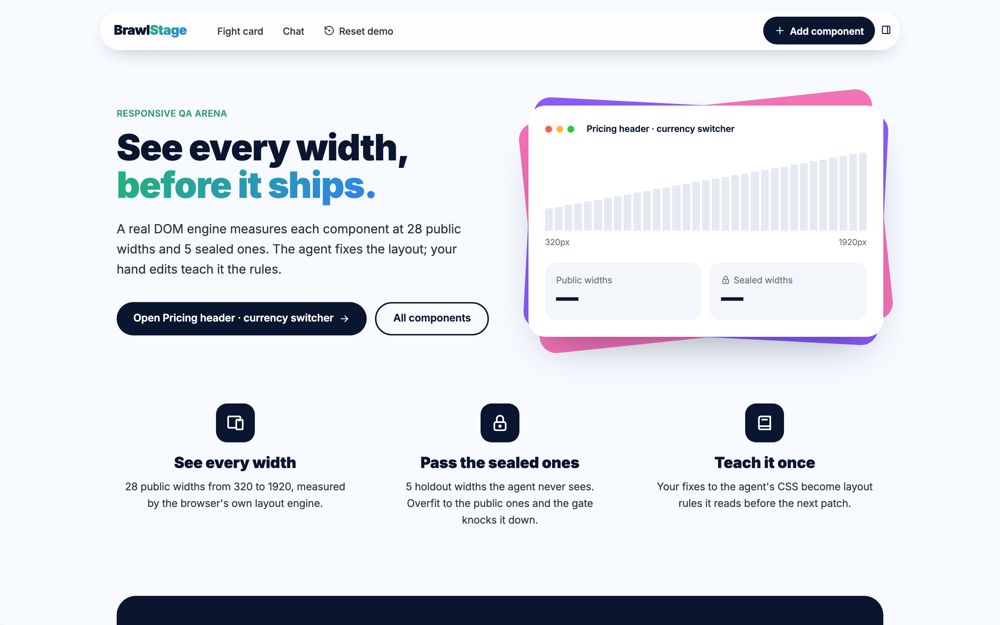
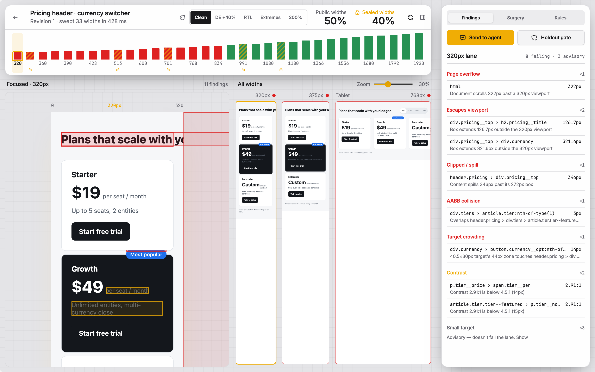
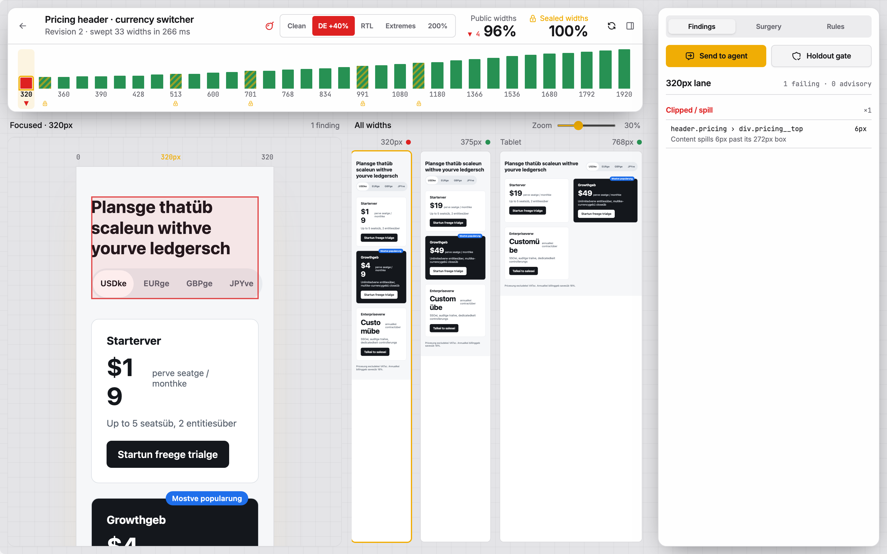
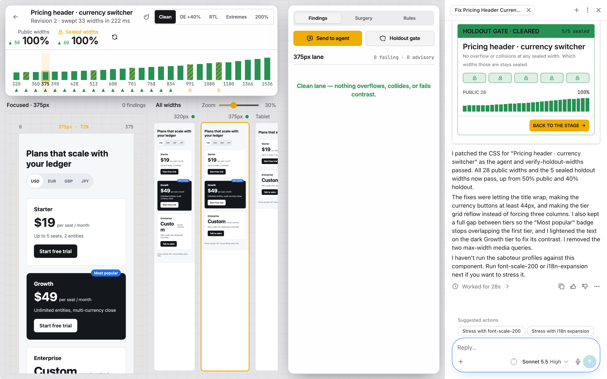

# BrawlStage — See Every Width Before It Ships

An adversarial responsive-QA arena built on [Agent-Native](https://www.agent-native.com) (`@agent-native/core`). A real browser layout engine sweeps your component across **28 public viewport widths** and **5 sealed holdout widths** in ~250 ms, a chaos saboteur stresses it with German (+40% text expansion), RTL direction flips, and 125% user font scaling, and the corner agent patches it on the same live stage. A component only clears the gate when its CSS flexes cleanly across widths the agent is never shown.

- **Walkthrough recording (2:28 Clips):** https://clips.agent-native.com/share/TEc36s8eLvqS
- **Recorded agent transcript (50% → 100% public, 40% → 100% sealed in 28 s):** [docs/agent-run.md](docs/agent-run.md)
- **Visual design contract:** [DESIGN.md](DESIGN.md)

```bash
npm install
npx agent-native dev        # http://localhost:8080/arena
```

---

## Why Held-Out Widths Matter

Front-end teams now hand responsive CSS bugs to coding agents. An agent that can see every test width will happily write media queries that pass `320 px` and `768 px` while breaking at `347 px`. BrawlStage seals five holdout widths away from every agent tool surface—just like held-out evaluation data in ML—so the only way through the gate is a genuinely fluid layout. When a human still steps in to refine the agent's CSS, their hand edit is diffed and banked as a rule the agent follows automatically on the next bout.



### Seeded Fight Card

- **Pricing header · currency switcher (`pricing-header`):** `nowrap` title, fixed `260 px` grid tracks, a featured badge colliding at narrow widths, and contrast loss on the dark featured tier card.
- **Fintech transaction rows (`ledger-rows`):** Fixed grid tracks, clipped merchant names, negative-margin badge collisions, and compact-mode icon crowding.
- **Freight nav bar (`freight-nav`):** Overflowing navigation link row and a low-contrast outline CTA.

---

## Live Bout Walkthrough (2 Minutes)

### Bout 1 — Sweep the 28 Public + 5 Sealed Lanes
Open **Pricing header · currency switcher** on `/arena`. The browser lays out and measures all 33 widths in ~250 ms using `getBoundingClientRect`, `scrollWidth > clientWidth`, `Range` line boxes, AABB intersection checks, and WCAG 2.1 `(L1 + 0.05) / (L2 + 0.05)` luminance contrast (`app/lib/dom-audit.ts`). Initially **50%** of public lanes and **40%** of sealed lanes pass.



### Bout 2 — Arm the Chaos Saboteur
Toggle **DE +40%** in the saboteur bar (`server/lib/saboteur.ts`). Deterministic German string expansion re-sweeps every lane and exposes latent overflow and badge collisions at narrow widths.



### Bout 3 — Send to the Corner Agent & Clear the Sealed Holdout Gate
Select a failing lane or violation box and press **Send to agent**. `<current-screen>` passes the open component, active width, DOM selector, and armed saboteur to the agent (`view-screen`), which patches the CSS via `patch-component-tokens` (`source: "agent"`). The open stage re-measures automatically and `verify-holdout-widths` checks whether all 5 sealed widths pass—reporting pass/fail per sealed lane without ever revealing which pixel widths they are.



### Bout 4 — Token Surgery & Banking Human Edits as Rules
Open **Surgery** to drag token sliders at pointer rate or hand-edit CSS (for example, stopping `"Custom"` from breaking mid-word at `320 px`), then click **Bank it as a layout rule** (`capture-design-learning`). BrawlStage computes an LCS line diff and CSS declaration delta against the agent's draft and writes the invariant to `learned_rules` and `.agents/skills/learned-layout-rules/SKILL.md`. Click **Reset demo → Reset, keep learned rules** (`reseed-arena`) and press **Send to agent** again: the agent's next patch applies your banked rule on the first pass.

---

## Anti-Gaming Architecture & Agent-Native Surfaces

<details open>
<summary><strong>Why the Holdout Gate Cannot Be Gamed</strong></summary>

1. **Redacted Agent Surfaces:** Sealed holdout widths and their specific violation boxes are stripped from `get-component`, `list-components`, and `view-screen`; the agent sees pass/fail counts per sealed lane only.
2. **Browser-Only Measurement Recording:** `record-viewport-audit` is locked to the real browser UI (`agentTool: false`, `uiOnly: true`)—no agent, CLI, or MCP client can submit synthetic measurements.
3. **Cryptographic State Hash Binding:** `verify-holdout-widths` throws `HOLDOUT_REGRESSION` (`409`) or `AUDIT_PENDING` if the measurement run's SHA-256 stage hash does not match the component's current HTML + CSS + token state.

</details>

<details open>
<summary><strong>Agent-Native Protocol Surfaces</strong></summary>

- **Unified `defineAction` Catalog (`actions/`):** Every arena operation is defined once and shared across the React UI, agent tool calls, CLI, HTTP, MCP, and A2A.
- **WebMCP (`window.__agentNativeWebMcp`):** The open stage registers `run-viewport-sweep` and `measure-stage-width` so an in-browser agent can trigger live iframe DOM measurements directly.
- **Real-Time Sync:** External CLI/MCP edits trigger automatic browser re-sweeps within seconds without reloading the page.
- **Generative UI & Data Programs:** Documented in `AGENTS.md` (inline token comparison card and pass-rate data program).

</details>

---

## Verification, Deployment & Known Boundaries

```bash
npm test
npm run typecheck
npx agent-native doctor
```

- **40 Vitest unit tests** verify WCAG contrast math against reference values, AABB collision detection, the 28 + 5 width protocol, holdout redaction and SHA-256 state-hash sealing, pass-rate arithmetic, CSS token injection guards, Saboteur determinism across all three seeded components, and directional LCS CSS diff extraction.
- **Production deployment:** Set `DATABASE_URL` (persistent PostgreSQL) and `BETTER_AUTH_SECRET` (`openssl rand -hex 32`), then build with `npm run build` (`NITRO_PRESET=vercel` on Vercel). Learned rules are stored in PostgreSQL (`learned_rules`) as well as `.agents/skills/learned-layout-rules/SKILL.md`, so they survive read-only serverless filesystems.
- **Scope boundaries:** Measurements run in a real browser engine (Chromium is the reference engine); components are self-contained HTML + CSS + tokens; contrast is evaluated against solid computed backgrounds rather than background images or gradients.
