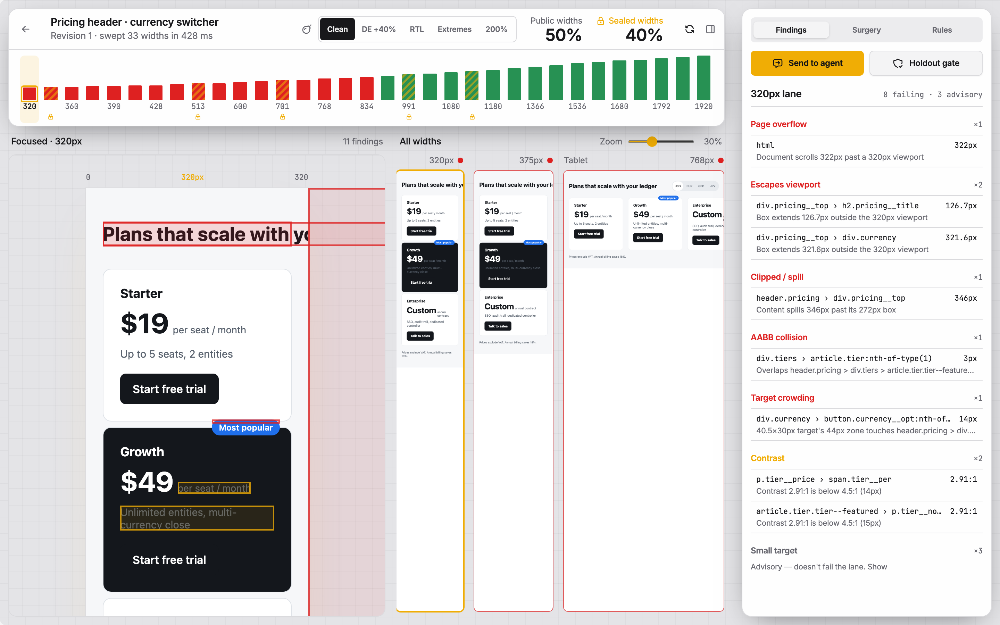
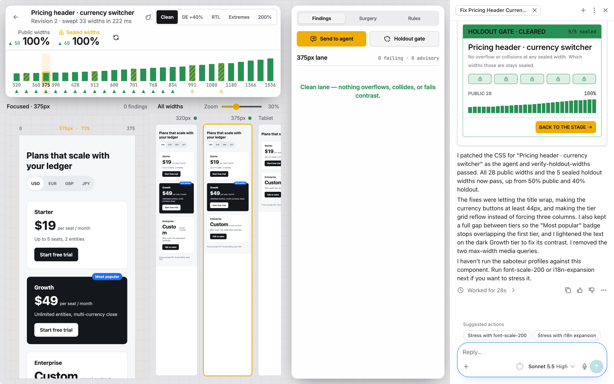

# Recorded agent run

One real run of the in-app agent on a local dev server (`npx agent-native dev`). The screenshots in the README come from this run.

| Step | Who | What happened |
|---|---|---|
| 1 | Developer | Opened *Pricing header · currency switcher*. The sweep measured 33 widths: **50%** of public widths and **40%** of sealed widths pass |
| 2 | Developer | Pressed **Send to agent** |
| 3 | Agent, 28 s | Patched the CSS as `agent`. The open stage re-measured every width |
| 4 | Server | `verify-holdout-widths` passed: **5/5 sealed widths**, with no holdout detail ever shown to the agent |
| 5 | Result | **100%** public, **100%** sealed |

What the agent wrote, verbatim:

> I patched the CSS for "Pricing header · currency switcher" as the agent and verify-holdout-widths passed. All 28 public widths and the 5 sealed holdout widths now pass, up from 50% public and 40% holdout.
>
> The fixes were letting the title wrap, making the currency buttons at least 44px, and making the tier grid reflow instead of forcing three columns. I also kept a full gap between tiers so the "Most popular" badge stops overlapping the first tier, and I lightened the text on the dark Growth tier to fix its contrast. I removed the two max-width media queries.

**What the gate does not catch:** at 320 px the agent's fix (`overflow-wrap: anywhere` on `.tier`) lets "Custom" and "$19" break mid-word. Nothing overflows, so every lane passes, but it looks wrong. That is the case Surgery is for: a person hand-edits the CSS, and **Bank it as a layout rule** turns the diff into a rule the agent reads next time.

## Repeatability across 5 fresh runs

Each run started from **Reset demo**, opened the pricing header and pressed **Send to agent**, with no other input.

| Run | Time | Holdout gate | Public | Sealed |
|---|---|---|---|---|
| 1 | 27 s | Cleared | 100% | 100% |
| 2 | 28 s | Cleared | 100% | 100% |
| 3 | 30 s | Cleared | 100% | 100% |
| 4 | 42 s | Cleared | 100% | 100% |
| 5 | 26 s | Cleared | 100% | 100% |
